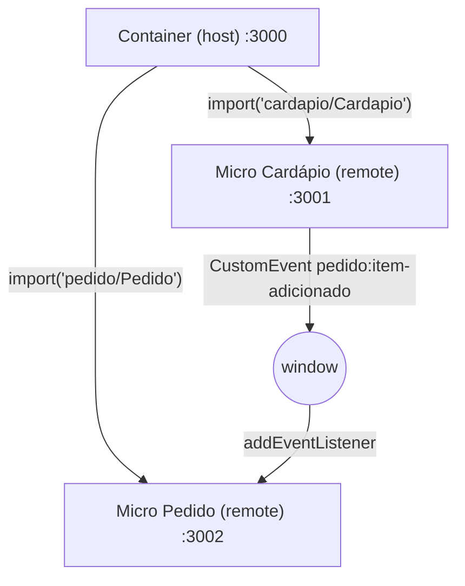

# Restaurante EBAC: Micro Frontends com Module Federation

Sistema de pedidos dividido em três aplicações Next.js independentes, integradas em tempo de execução com **Webpack Module Federation**.

| App | Papel | Porta | O que faz |
| --- | --- | --- | --- |
| `apps/container` | Host | 3000 | Página principal; carrega os dois micros |
| `apps/cardapio` | Remote | 3001 | Lista de pratos com botão "Adicionar ao pedido". Expõe `./Cardapio` |
| `apps/pedido` | Remote | 3002 | Itens adicionados, quantidades e total. Expõe `./Pedido` |

## Arquitetura



## Tecnologias

- Next.js 14.2 (**Pages Router**): o plugin de Module Federation suporta apenas Next 12 a 15 com Pages Router
- React 18
- `@module-federation/nextjs-mf` 8.8
- Webpack 5.98 (travado via `overrides`; versões mais novas são incompatíveis com o plugin)
- npm workspaces (monorepo)
- CSS Modules

## Como rodar

Pré-requisito: Node.js 18.17 ou superior.

```bash
npm install      # instala as dependências dos três apps
npm run dev      # sobe os três apps juntos
```

Acesse **http://localhost:3000**.

### Rodar cada micro individualmente

```bash
npm run dev -w cardapio    # http://localhost:3001
npm run dev -w pedido      # http://localhost:3002 (tem botão para simular eventos)
npm run dev -w container   # http://localhost:3000 (precisa dos dois remotes rodando)
```

### Produção

```bash
npm run build
npm start
```

## Como funciona a comunicação entre os micros

Os micros **não importam código um do outro**. Eles se comunicam por um evento global do navegador, seguindo um contrato definido em `events/pedidoEvents.js` (o mesmo arquivo nos dois micros):

| Evento | Emissor | Ouvinte | Payload (`event.detail`) |
| --- | --- | --- | --- |
| `pedido:item-adicionado` | Cardápio | Pedido | `{ id: string, nome: string, preco: number }` |

1. O usuário clica em "Adicionar ao pedido" no Cardápio.
2. O Cardápio chama `window.dispatchEvent(new CustomEvent('pedido:item-adicionado', { detail }))`.
3. O hook `usePedido` do Pedido escuta o evento com `window.addEventListener` e atualiza o estado (o mesmo prato aumenta a quantidade).
4. O listener é removido no cleanup do `useEffect`, evitando duplicidade.

Como o único acordo é o nome do evento e o formato do payload, cada micro pode ser alterado e publicado sem mexer no outro.

## Como o Module Federation está configurado

- **Remotes** (`apps/cardapio` e `apps/pedido`): `NextFederationPlugin` com `name`, `filename: 'static/chunks/remoteEntry.js'` e `exposes`.
- **Host** (`apps/container`): `NextFederationPlugin` com `remotes` apontando para o `remoteEntry.js` de cada micro (`ssr` no servidor, `chunks` no navegador).
- O container carrega os micros com `React.lazy` + `Suspense`, apenas no navegador, e envolve cada um num Error Boundary.
- React e React DOM são compartilhados como singleton pelo próprio plugin.

## Estrutura

```
apps/
├── cardapio/   components/ data/ events/ pages/ styles/
├── pedido/     components/ hooks/ events/ pages/ styles/
└── container/  components/ pages/ styles/
```
